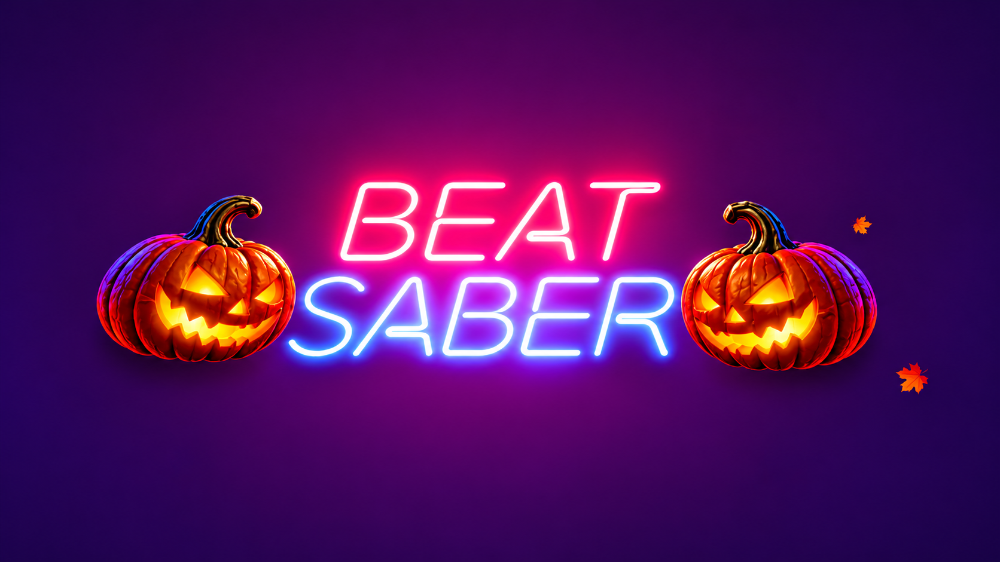

## 🎃 Halloween Theme — Video

Watch Halloween Theme in action!

▶️ **Watch on YouTube:** https://www.youtube.com/watch?v=LgSdA3DGreM

Happy Halloween!

Transform your Beat Saber menu into a spooky graveyard with falling autumn leaves.
Based on the fantastic Christmas Mod by Vcmikuu and CatsaCode. Free music provided by the brilliant Alex Morgan.

Note: Development assisted with use of A.I. Please support talented artists and coders whenever possible.

**Compatible with:** Beat Saber 1.40.8 (Quest)

## License and source code

This project is a modified derivative of [Christmas Theme](https://github.com/vcmikuu/ChristmasTheme), created by **CatsaCode** and **laynia (vcmikuu)**. It contains modified Christmas Theme code alongside new seasonal modifications. The original developers have [authorized reuse under GNU GPL version 3 with proper credit](https://github.com/vcmikuu/ChristmasTheme/issues/1#issuecomment-6711835142).

The combined mod's code is distributed under the **GNU General Public License, version 3 (GPL-3.0-only)**. See the [LICENSE](LICENSE) file for the complete terms. You may study, modify, and redistribute the covered code under GPLv3, subject to its requirements. This is not an official release by the Christmas Theme developers.

**Source and binaries:** The [GitHub repository](https://github.com/Abomination2169/Halloween-Theme) contains the mod's source and build configuration; the [releases page](https://github.com/Abomination2169/Halloween-Theme/releases) provides downloadable QMODs and source archives. For each binary release, use the matching version/tag of the source, not necessarily the latest `main` branch. The source supplied for a QMOD must correspond to that build; release assets and source archives require review to confirm this.

## Attribution and modifications

- **CatsaCode and laynia (vcmikuu):** Creators of the original [Christmas Theme](https://github.com/vcmikuu/ChristmasTheme), on whose source this mod is based. Thank you both for your work and permission.
- **Abomination2169:** Seasonal adaptation, code and asset changes, maintenance and distribution of Halloween Theme.
- **Quest Mod Template:** By [Lauriethefish, danrouse and Bobby Shmurner](https://github.com/Lauriethefish/quest-mod-template), originally provided under the Unlicense. Credit also goes to the dependency/library authors acknowledged in [Christmas Theme's README](https://github.com/vcmikuu/ChristmasTheme#credits).

This mod substantially changes the original Christmas setting into a halloween theme, including its seasonal effects and presentation. These modifications were made in 2026. Development was assisted with AI; please support the original artists and developers. Third-party assets, audio, and dependencies may carry their own licenses and require separate review; GPLv3 permission for Christmas Theme code does not automatically cover them.
